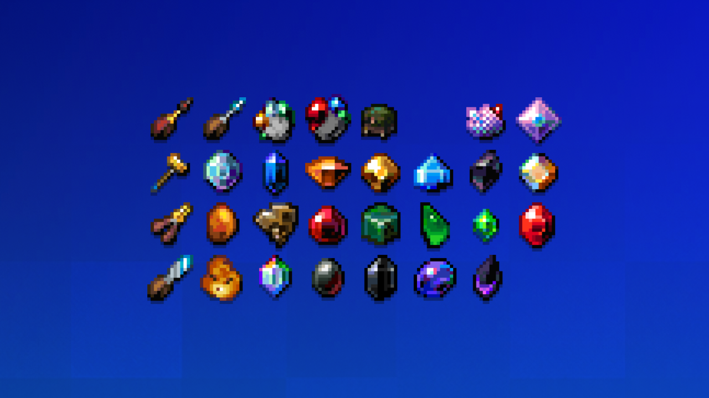
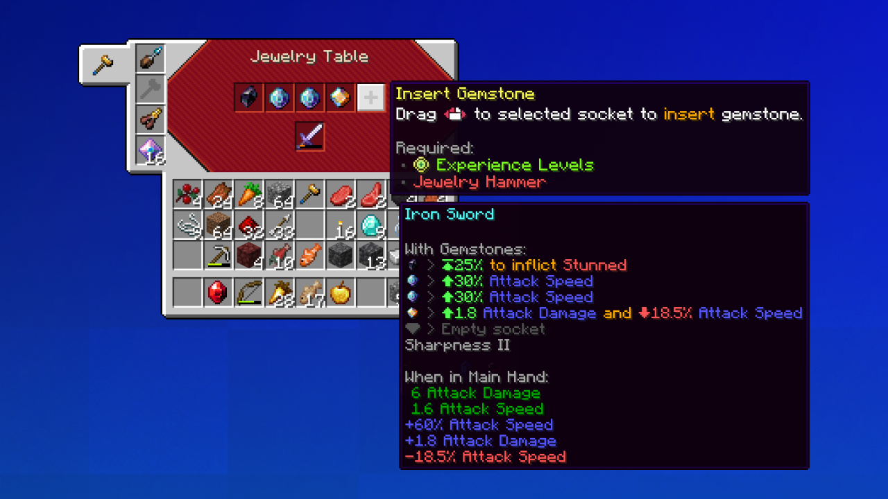

## Legendary Gemstones

Adds various gemstones to your world that can be used to upgrade weapons, tools,
and armor. Gemstones are inserted into special sockets on equipment and give the
owner unique bonuses.

- 20 various Gemstones!
- 50+ unique bonuses and effects!

## Getting Started

1. **Find gemstones.** Ores can drop a **Gemstone Geode**. Hold it and press
   right click to open it for a random gemstone. Some gemstones can also be found
   in structures such as piglin bastions in the Nether, strongholds, End cities,
   and other loot chests.
2. **Craft a Jewelry Table**.
3. **Socket your gear.** Put a weapon, tool or armor piece in the table and click
   a socket:
   - **Jewelry Hammer** inserts the gemstone you hold on the cursor;
   - **Jewelry Pliers** take a gemstone out;
   - a **Chisel** with an **Expansion Crystal** unlocks a new socket.

   Inserting and extracting costs experience levels. Hover over a socket to see
   what it needs.
4. **Improve your gemstones.** Grind spare gemstones in a Grindstone into
   **Gemstone Dust**, then polish the ones you keep to a higher quality with the
   **Jewelry File**.

For recipes, bonuses and drop chances go to the mod [Wiki](https://gemstones.anivire.xyz/).

## Requirements

- Minecraft 1.21.1, Fabric (with Fabric API) or NeoForge
- [Architectury API](https://modrinth.com/mod/architectury-api)
- Optional: REI or EMI for recipes, Cloth Config for the settings screen

## Credits

- Huge thanks [@8o1y_ra](https://x.com/8o1y_ra) for amazing gemstones and tools sprites!
- Thanks [@YoukaiDrawing](https://x.com/YoukaiDrawing) for Jewelry Table sprite!
